# Diagrama bazei de date (ER)

Diagrama e scrisa in Mermaid. Se poate vedea direct pe GitHub sau se poate
copia blocul de mai jos (fara liniile cu ```) in https://mermaid.live

Pe elev + materie + zi exista fie un rand in `grades`, fie unul in
`absences`, niciodata amandoua (verificat de aplicatie in tranzactie).

Fiecare tabela cu `school_id` apartine unei scoli; la stergerea scolii se
sterg si randurile ei (`ON DELETE CASCADE`). La fel, stergerea unui cont din
`users` sterge profilul si datele legate de el. Exceptii (`RESTRICT`): o
clasa cu elevi sau cu ore in orar nu poate fi stearsa, iar un cont care e
directorul activ al unei scoli nu poate fi sters. La stergerea unui profesor,
rapoartele lui raman, cu `teacher_id = NULL`.

Tabelele `refresh_tokens` si `password_reset_tokens` tin doar hash-ul
tokenului. `class_teachers` exista in schema, dar nu este folosit inca de
aplicatie (profesorii ajung la o clasa prin orar).

```mermaid
erDiagram
    schools ||--o{ users : "are conturi"
    users |o--o| schools : "director activ"
    schools ||--o{ directors : "are"
    schools ||--o{ teachers : "are"
    schools ||--o{ students : "are"
    schools ||--o{ school_classes : "are"
    schools ||--o{ subjects : "are"
    schools ||--o{ teacher_subjects : "are"
    schools ||--o{ class_teachers : "are"
    schools ||--o{ timetable_slots : "are"
    schools ||--o{ grades : "are"
    schools ||--o{ grade_edit_requests : "are"
    schools ||--o{ absences : "are"
    schools ||--o{ conduct_requests : "are"

    users ||--o| directors : "profil"
    users ||--o| teachers : "profil"
    users ||--o| students : "profil"
    users ||--o{ refresh_tokens : "sesiuni"
    users ||--o{ password_reset_tokens : "resetari parola"

    school_classes ||--o{ students : "contine"
    teachers ||--o{ teacher_subjects : "poate preda"
    subjects ||--o{ teacher_subjects : "e predata de"
    school_classes ||--o{ class_teachers : "are profesori"
    teachers ||--o{ class_teachers : "la clase"

    school_classes ||--o{ timetable_slots : "ore"
    subjects ||--o{ timetable_slots : "ore"
    teachers ||--o{ timetable_slots : "preda"

    students ||--o{ grades : "primeste"
    subjects ||--o{ grades : "la materia"
    teachers ||--o{ grades : "pune"
    grades ||--o{ grade_edit_requests : "cereri editare"
    students ||--o{ grade_edit_requests : "pentru elev"
    subjects ||--o{ grade_edit_requests : "la materia"
    teachers ||--o{ grade_edit_requests : "cere"

    students ||--o{ absences : "are"
    subjects ||--o{ absences : "la materia"
    teachers ||--o{ absences : "pune"

    students ||--o{ conduct_requests : "purtare"
    teachers ||--o{ conduct_requests : "cere"

    schools ||--o{ activity_reports : "jurnal"
    teachers |o--o{ activity_reports : "autor"

    schools {
        int id PK
        varchar name
        varchar slug UK "folosit in /login/slug"
        varchar address "optional"
        varchar phone "optional"
        int director_user_id FK "directorul activ, RESTRICT la stergere"
        datetime created_at
        datetime updated_at
    }

    users {
        int id PK
        varchar email UK
        varchar password_hash "bcrypt"
        enum role "DIRECTOR, TEACHER, STUDENT"
        int school_id FK
        boolean must_change_password
        boolean is_active
        int token_version "creste la schimbarea parolei"
        datetime created_at
        datetime updated_at
    }

    directors {
        int id PK
        int user_id FK, UK
        int school_id FK
        varchar first_name
        varchar last_name
        datetime created_at
        datetime updated_at
    }

    teachers {
        int id PK
        int user_id FK, UK
        int school_id FK
        varchar first_name
        varchar last_name
        decimal hours_taught
        datetime created_at
        datetime updated_at
    }

    students {
        int id PK
        int user_id FK, UK
        int school_id FK
        int class_id FK "RESTRICT la stergerea clasei"
        varchar first_name
        varchar last_name
        date birth_date "optional, varsta 5-25 ani"
        decimal conduct_grade "CHECK 1-10"
        datetime created_at
        datetime updated_at
    }

    school_classes {
        int id PK
        int school_id FK
        varchar name "unic in scoala"
        varchar description "optional"
        datetime created_at
        datetime updated_at
    }

    subjects {
        int id PK
        int school_id FK
        varchar name
        datetime created_at
        datetime updated_at
    }

    teacher_subjects {
        int id PK
        int school_id FK
        int teacher_id FK "unic: profesor + materie"
        int subject_id FK
        datetime created_at
    }

    class_teachers {
        int id PK
        int school_id FK
        int class_id FK "unic: clasa + profesor"
        int teacher_id FK
        datetime created_at
    }

    timetable_slots {
        int id PK
        int school_id FK
        int class_id FK "RESTRICT la stergerea clasei"
        int subject_id FK
        int teacher_id FK
        tinyint day_of_week "CHECK 1-7, API-ul accepta doar 1-5"
        varchar start_time "HH:mm, CHECK start < end, unic: clasa + zi + inceput"
        varchar end_time "HH:mm"
        varchar room "optional"
        datetime created_at
        datetime updated_at
    }

    grades {
        int id PK
        int student_id FK
        int subject_id FK
        int teacher_id FK
        int school_id FK
        decimal value "CHECK 1-10, max 2 zecimale"
        enum type "NORMAL sau THESIS (teza)"
        date graded_on "unic: elev + materie + zi"
        datetime created_at
        datetime updated_at
    }

    grade_edit_requests {
        int id PK
        int school_id FK
        int grade_id FK
        int student_id FK
        int subject_id FK
        int teacher_id FK
        decimal current_value "CHECK 1-10"
        decimal proposed_value "CHECK 1-10"
        text teacher_reason
        text director_reason "dupa decizie"
        enum status "PENDING, APPROVED, REJECTED"
        datetime created_at
        datetime updated_at
    }

    absences {
        int id PK
        int school_id FK
        int student_id FK
        int subject_id FK
        int teacher_id FK
        date absent_on "unic: elev + materie + zi"
        boolean motivated "doar directorul motiveaza"
        varchar motivated_reason "optional"
        datetime motivated_at
        datetime created_at
    }

    conduct_requests {
        int id PK
        int school_id FK
        int student_id FK
        int teacher_id FK
        decimal proposed_grade "CHECK 1-10"
        text teacher_reason
        text director_reason "dupa decizie"
        enum status "PENDING, APPROVED, REJECTED"
        datetime created_at
        datetime updated_at
    }

    activity_reports {
        int id PK
        int school_id FK
        int teacher_id FK "SET NULL la stergere"
        enum type
        text description
        decimal hours_delta
        json metadata
        datetime created_at
    }

    refresh_tokens {
        int id PK
        int user_id FK
        char family_id
        char token_hash UK "sha256"
        int token_version
        boolean remember_me
        datetime expires_at
        datetime used_at
        datetime revoked_at
        datetime created_at
    }

    password_reset_tokens {
        int id PK
        int user_id FK
        char token_hash UK "sha256"
        datetime expires_at
        datetime used_at
        datetime created_at
    }
```


